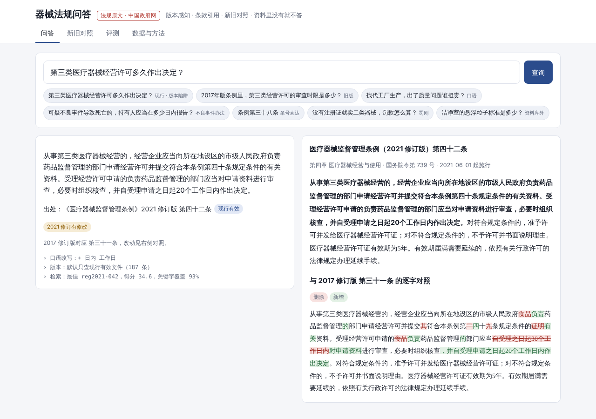

# med-device-reg-qa：器械法规问答

个人项目。法规原文来自中国政府网，都是真实文本。

> **一句话**：在真实的《医疗器械监督管理条例》2017 / 2021 修订版和《医疗器械不良事件监测和再评价管理办法》上做问答。默认按现行版本回答、逐条标注出处；条款在修订中改过的，同时给出新旧逐字对照；资料里没有答案的问题不回答。



## 解决什么问题

注册、质量、合规人员每天都要查法规，最容易出错的有三处：

1. **答成已废止的旧规定**。条例 2021 年大修，条号从 80 条重排到 107 条，很多时限和罚则都变了。例如第三类经营许可的审查时限从 30 个工作日改为 20 个工作日，无证生产的罚款从货值 10–20 倍提高到 15–30 倍。
2. **口语和法规用语对不上**。大家说「外包」「UDI」「没拿到证」，条文写的是「委托生产」「唯一标识」「未取得」。
3. **没有依据还硬答**。资料库里没有的问题（洁净室标准、税率、医保），大模型也会编出一个答案。

## 亮点

- **真实法规，严格结构化**：网页正文切分成「文件 → 章 → 条」，逐一校验条号连续（80 / 107 / 80 条，无缺号），每条标注版本、文号、施行日期和效力状态。
- **版本感知**：默认只查现行有效文件；问题里出现「旧版、2017、修订前、原来」等词时才查已废止版本。开发集 10 道版本陷阱题里，不分版本检索时有 3 道答成旧规定，加版本过滤后为 0。
- **新旧条款自动对照**：条号整体重排，不能按条号对。系统按字符级 TF-IDF 余弦相似度一对一配对，再用 difflib 逐字比对：新增 31 条、修改 53 条、基本未变 23 条、删除或并入 4 条。回答时若该条在修订中改过，自动附上旧版原文和逐字差异。
- **资料外拒答**：问题关键字在最佳条款里的覆盖率不到 55% 就拒答，无答案题全部正确拒答。
- **诚实评测**：开发集、留出集、第二留出集分开报告。留出集暴露出「口语对不上法规用语」，加了改写表后又重新写了一套新题来验证，没有只在看过的题上刷分。
- **前端实时运行**：演示页里的问答引擎是用 JS 重写的同一套算法，47 道评测题在 Python 和 JS 中的结果逐条一致（`cmp.js`）。

**技术栈**：Python · BM25（字符二元组）· 版本过滤 / 条号路由 · 可答性门槛 · difflib 条款对照 · 原生 JS 前端 · unittest；可扩展为 bge-m3 向量 + BM25 混合召回，加 Qwen 生成带引用的总结。

## 评测

| 题集 | 管线 | 答对率 | 答成旧版 | 无答案题拒答 | Top-3 命中 |
|---|---|---|---|---|---|
| 开发集（24） | 纯检索 | 58% | 3/10 | 0% | 81% |
| 开发集 | + 版本过滤、条号直达 | 88% | 0/10 | 33% | 95% |
| 开发集 | + 可答性门槛 | 96% | 0/10 | 100% | 95% |
| 开发集 | + 口语改写（完整版） | 96% | 0/10 | 100% | 100% |
| 留出集（12） | 纯检索 | 42% | 0/4 | 0% | 60% |
| 留出集 | + 可答性门槛 | 67% | 0/4 | 100% | 70% |
| 留出集 | 完整版 | 92% | 0/4 | 100% | 100% |
| **第二留出集（11）** | 纯检索 | 36% | 0/5 | 0% | 67% |
| **第二留出集** | **完整版** | **82%** | 0/5 | 100% | 100% |

说明：留出集在加口语改写之前跑过一次（67%），改写表就是根据它的失败加的，所以它之后的 92% 不能算无偏。第二留出集是改写表加好之后才写的新题，**82% 是更可信的数字**。

完整版仍答错的 4 道题（如实保留）：

- 定义类问题（「什么是严重伤害」）命中了使用该词的条款，而不是「用语含义」条款；
- 「停产」命中了监管部门的控制措施条款，而不是持有人义务条款；
- 「开一家卖三类器械的店」同时命中生产许可和经营许可，没区分开；
- 「医院」在法规里叫「使用单位」，改写表里没有这一项。

## 运行

```bash
python -m regqa.parse        # 切分法规（data/raw/regs.json → data/clean/articles.jsonl）
python -m regqa.align        # 2017 ↔ 2021 条款对照
python -m regqa.run_eval     # 三套题 × 四条管线，结果写到 results/
python -m regqa.export_web   # 导出前端数据
python -m regqa.qa "找代工厂生产，出了质量问题谁担责？"
python -m unittest discover -s tests -t .
cd web && python -m http.server 8000
```

## 数据来源

| 文件 | 版本 | 来源 |
|---|---|---|
| 医疗器械监督管理条例 | 2017 修订版（国务院令第 680 号），2021-06-01 废止 | https://www.gov.cn/gongbao/content/2017/content_5197006.htm |
| 医疗器械监督管理条例 | 2021 修订版（国务院令第 739 号），现行 | https://www.gov.cn/gongbao/content/2021/content_5595920.htm |
| 医疗器械不良事件监测和再评价管理办法 | 市场监管总局、国家卫健委令第 1 号，2019-01-01 施行 | https://www.gov.cn/zhengce/2021-06/24/content_5728115.htm |

下一步：加入 2025 年新版《医疗器械生产质量管理规范》（2026-11-01 施行，2014 版同日废止），这是眼下质量体系最真实的版本陷阱。

本项目仅作技术演示，不构成法律意见；实际适用以官方发布文本为准。
